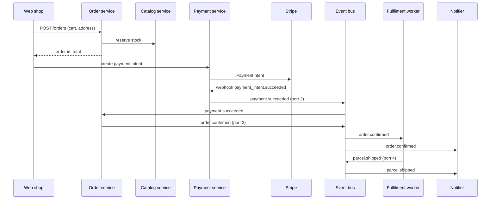

# Corner Shop: architecture

A small online shop: people browse a catalog, pay by card and get their parcel. Staff manage stock and refunds from a back office. This document is the input for the `archivision arch` example.

## Areas

- **Storefront**: what customers use (web shop and emails).
- **Services**: the backend services behind the storefront and the back office.
- **Data and outside services**: the database, the event bus and the providers we pay.

## Blocks

### Web shop (Next.js)
- *Catalog pages* list products and search them through the Catalog service.
- *Cart* keeps the basket in a cookie and asks the Pricing step of the Order service for totals.
- *Checkout* collects the address and opens the Stripe payment sheet.
- *Account* shows past orders from the Order service.

### Back office (Next.js, staff only)
- *Stock editor* changes quantities through the Catalog service.
- *Refunds* asks the Payment service to refund an order.
- Staff sign in with Google Workspace through the Auth gate.

### Auth gate
Checks sessions for both apps. Customers use email links; staff use Google Workspace SSO. Exposes `GET /session`.

### Catalog service
- `GET /products`, `GET /products/:id`, `PATCH /stock/:sku`.
- Keeps products and stock in Postgres (tables `products`, `stock`).
- Publishes `stock.changed` on the event bus when a quantity changes.

### Order service
Steps, in order: **Receive** (`POST /orders` from Checkout), **Price** (applies the price list and the discount codes), **Reserve** (holds stock by calling the Catalog service), **Confirm** (waits for `payment.succeeded`), **Keep** (writes `orders` and `order_lines`).
Publishes `order.confirmed`.

### Payment service
Wraps Stripe. Creates payment intents for Checkout, receives Stripe webhooks at `POST /stripe/webhook`, publishes `payment.succeeded` and `payment.failed`, and runs refunds for the back office.

### Fulfilment worker
Subscribes to `order.confirmed`, buys a label from the Sendcloud API and publishes `parcel.shipped`.

### Notifier
Subscribes to `order.confirmed` and `parcel.shipped` and sends emails through Postmark using the templates `order-confirmed` and `parcel-on-its-way`.

## The event bus

NATS, with numbered subjects so the diagram stays readable:

| Port | Subject | Publishers | Subscribers |
|---|---|---|---|
| 1 | `stock.changed` | Catalog service | Web shop (cache refresh) |
| 2 | `payment.succeeded` / `payment.failed` | Payment service | Order service |
| 3 | `order.confirmed` | Order service | Fulfilment worker, Notifier |
| 4 | `parcel.shipped` | Fulfilment worker | Notifier |

## Main flow

## Refunds

Back office → Payment service (`POST /refunds`) → Stripe refund → `payment.failed` is **not** used for refunds; the Payment service writes the refund to its own `refunds` table. Whether the Order service should hear about refunds is still open.
